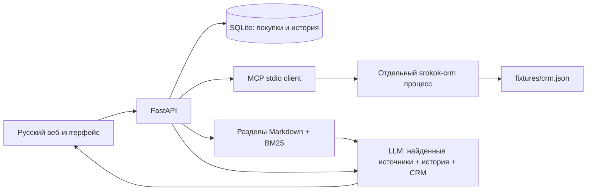

# День 33 — СрокОК: продукт и AI-поддержка

**Видео-демо:** [day33-demo.mp4 на Яндекс.Диске](https://yadi.sk/i/b3btocsGf_yvEw) — реальный публичный сервис: покупка, два тикета, ответы Qwen, FAQ, MCP и уточнение с историей.

**Сервис:** [СрокОК](https://srokok.176.53.175.196.sslip.io/).
**Видео:** [реальная запись работы](https://srokok.176.53.175.196.sslip.io/demo.mp4).
**Код:** [скачать исходники ZIP](https://srokok.176.53.175.196.sslip.io/code.zip).
План до реализации: [PLAN.md](PLAN.md). Сценарий записи: [DEMO.md](DEMO.md).

СрокОК — простой журнал гарантий на покупки. Сохраните название, дату покупки,
срок в месяцах, магазин и заметку: кабинет вычисляет дату окончания, показывает
остаток дней и позволяет выгрузить JSON. Данные сохраняются на VPS в SQLite.
Во вкладке «Поддержка» работает AI-ассистент с RAG и контекстом тикета через MCP.

## Как пользоваться

1. Откройте сервис, нажмите «Добавить покупку», заполните поля и сохраните.
2. Используйте фильтр «Истекают скоро» или «Экспорт JSON».
3. Перейдите в «Поддержка», выберите обращение и задайте вопрос либо нажмите подсказку.
4. Откройте источники ответа: полные статьи доступны по ссылкам возле абзацев.
5. Справа видны пользователь и события обращения. В «MCP · подключение к CRM»
   можно проверить реально вызванный инструмент и его аргументы.

Для проверки контекста сравните SK-1042 и SK-1043 с одним вопросом:
«Почему не работает авторизация?». Первый содержит истёкшую ссылку LINK_EXPIRED,
второй — открытие письма в другом браузере SESSION_MISMATCH.

**Границы v1:** регистрация, email-login, синхронизация между устройствами,
загрузка чеков, редактирование/удаление, импорт и отправка напоминаний не реализованы.
В действующем продукте доступ определяется случайной HttpOnly cookie браузера.
Не удаляйте её до экспорта: восстановление связи с кабинетом не предусмотрено.
Тикеты, имена, почта example.test и события email-login — явно вымышленные данные
демонстрационной CRM. Личные покупки посетителя с ними не смешиваются.
Расчёт срока — учёт пользовательских данных, а не юридическая гарантия магазина.

## Реальный RAG и MCP



- Пять документов / 12 разделов FAQ в `knowledge/`; русский поиск BM25 с небольшой
  нормализацией слов, версия индекса — SHA-256 корпуса. Большой embedding-runtime
  для этого корпуса не требуется. Это лексический retrieval, не векторный поиск.
- Запрос RAG учитывает вопрос, предшествующие вопросы и события выбранного тикета.
- JSON CRM открывает исключительно `crm_mcp_server.py`, работающий отдельно.
  Клиент делает настоящие `initialize`, `tools/list`, `tools/call` через SDK mcp 2.2.0.
  Инструменты: `list_tickets`, `get_ticket_context(ticket_id)`; только чтение.
- Генерация отдаёт абзацы с ID источников. Сервер проверяет структуру и существование
  цитат в retrieved-наборе. Семантическое соответствие каждого утверждения источнику
  не гарантируется машинной валидацией; пользователь может открыть статью.
- Модель не получает инструменты записи и не может изменить аккаунт или покупку.
  История определяется сервером по сессии + тикету; клиент не присылает чужую историю.
  При ошибке провайдера возвращается явная ошибка, без шаблонного успешного ответа.

## Запуск локально

Python 3.12+, Node для записи видео. Ключ задаётся в окружении и не сохраняется в код.

```powershell
python -m venv day33-support-assistant/.venv
day33-support-assistant/.venv/Scripts/python.exe -m pip install -r day33-support-assistant/requirements.txt
# GEMINI_API_KEY уже задан в окружении
day33-support-assistant/.venv/Scripts/python.exe day33-support-assistant/server.py
```

Откройте [локальный кабинет](http://127.0.0.1:8833/).
Без ключа покупки и статьи работают; попытка AI-ответа честно вернёт ошибку.
Для OpenRouter:

```powershell
$env:DAY33_PROVIDER = 'openrouter'
$env:DAY33_MODEL = 'openrouter/free'
# OPENROUTER_API_KEY должен быть задан в окружении
day33-support-assistant/.venv/Scripts/python.exe day33-support-assistant/server.py
```

Допускаются только `openrouter/free` и модели с суффиксом `:free`; платного fallback нет.
Фактически выбранная OpenRouter модель возвращается в каждом ответе и видна в UI.
На VPS Gemini вернул HTTP 400, OpenRouter — HTTP 403. Рабочий сервер использует
Wormsoft / `qwen/qwen3.8:27b` (фактический ID ответа `qwen3.8-27b`). Локально Gemini
успешно прошёл две реальные проверки. Код поддерживает все три провайдера,
без автоматического переключения на другой платный маршрут.
Для Wormsoft задайте `DAY33_PROVIDER=wormsoft` и `WORMSOFT_API_KEY` в окружении.
URL и модель по умолчанию импортируются из `day18-rss-scheduler/day18_providers.py`:
при переносе отдельной папки нужно также сохранить этот модуль дня 18.
Qwen вызывается с отключённым thinking: это предотвращает расход лимита ответа
на рассуждения вместо итогового текста.

| Переменная | Значение по умолчанию |
|---|---|
| DAY33_HOST / DAY33_PORT | 127.0.0.1 / 8833 |
| DAY33_DATA_DIR | data/ рядом с кодом |
| DAY33_CRM_PATH | fixtures/crm.json |
| DAY33_KNOWLEDGE_DIR | knowledge/ |
| DAY33_PROVIDER | gemini; также openrouter и wormsoft |
| DAY33_MODEL | зависит от провайдера; Wormsoft импортирует дефолт дня 18 |
| DAY33_DAILY_LIMIT | 200 попыток генерации за день |
| DAY33_TIMEZONE | Asia/Yekaterinburg |
| DAY33_SECURE_COOKIE | 0 локально, 1 на VPS |

## Развёртывание на существующей VPS

Использована капсула дня 18. Код: `/home/user/ai-advent/day33-support-assistant`,
данные: `/home/user/ai-advent/data/day33`, служба: `day33-support.service`.
FastAPI слушает localhost:8833, Caddy — 80/443 с автоматическим сертификатом
и перенаправлением HTTP → HTTPS. Домен sslip.io разрешается в существующий IP VPS.
Он нужен для HTTPS; собственного домена покупать не требовалось.

`deploy/install.sh` создаёт venv, устанавливает зависимости, отдельную службу
и отдельный Caddy host. Ключ передаётся `deploy/send_environment.py` через stdin SSH,
без значений в аргументах и логах; файл окружения вне Git с правами 0600.
Служба работает от обычного пользователя, с автозапуском и лимитом памяти 512 МБ.
Ключ не передаётся MCP-процессу. Публичная страница дня 18 и таймеры сохранены.

```powershell
# После копирования папки day33-support-assistant через scp:
ssh -i "$env:USERPROFILE/.ssh/ai_advent_vps" user@176.53.175.196 'DAY33_PUBLIC_HOST=srokok.176.53.175.196.sslip.io bash /home/user/ai-advent/day33-support-assistant/deploy/install.sh'
$env:DAY33_PROVIDER = 'wormsoft'
python day33-support-assistant/deploy/send_environment.py --target user@176.53.175.196 --key "$env:USERPROFILE/.ssh/ai_advent_vps" --app-dir /home/user/ai-advent/day33-support-assistant
ssh -i "$env:USERPROFILE/.ssh/ai_advent_vps" user@176.53.175.196 'sudo -n systemctl restart day33-support.service && sudo -n systemctl reload caddy'
```

Состояние: `systemctl is-active day33-support.service caddy`; автозапуск:
`systemctl is-enabled day33-support.service caddy`; журнал:
`sudo journalctl -u day33-support.service -n 30 --no-pager`.
`/healthz` проверяет SQLite и наличие индекса; это не проверка доступности LLM.
Корпус/CRM обновляются оператором через файлы, индекс пересоздаётся при перезапуске.

## Ограничения и проверки

До 6 вопросов в минуту на сессию, 2 параллельные генерации, очередь до 5 секунд,
таймаут провайдера 65 секунд, вопрос до 1200 символов, контекст до 26000 символов,
ответ до 2400 токенов. Дневной лимит попыток хранится в SQLite и не сбрасывается
перезапуском. Ограничения самого провайдера могут сработать раньше.
До 500 покупок на сессию. В публичной demo CRM нет реальных персональных данных;
продукт без регистрации не подходит для конфиденциального хранения чеков.

```powershell
python day33-support-assistant/verify.py
$env:DAY33_VERIFY_URL = 'https://srokok.176.53.175.196.sslip.io'
python day33-support-assistant/verify_live.py
node --check day33-support-assistant/web/app.js
```

`verify.py` проверяет настоящий MCP и детерминированные API-сценарии с тестовым
провайдером: календарные границы, persistence, разные сессии/тикеты, CSRF,
валидацию, лимиты и отказ LLM. `verify_live.py` делает два настоящих AI-запроса.
Результаты и браузерные проверки хранятся в [evidence/](evidence/).
Видео: локальный `ChallengeVideos/day33-demo.mp4`, никогда не добавляется в Git.

Приёмка 14.10.2026: **457 тестов репозитория прошли** (включая день 33),
11 групп отдельных проверок, два публичных запроса с разными тикетами,
три живых ответа в видеодемо, проверки отказа от выдуманных действий,
HTTPS и перезапуска с сохранением данных. Ролик: 79,68 с, H.264, 1440×1000,
25 fps; 1 746 179 байт. Временные кадры и профиль браузера не входят в код.

Использованные первичные API-источники: [MCP Python SDK](https://py.sdk.modelcontextprotocol.io/),
[Gemini JSON](https://ai.google.dev/gemini-api/docs/generate-content/structured-output),
[OpenRouter](https://openrouter.ai/docs/guides/features/structured-outputs),
[Qwen thinking](https://qwen.readthedocs.io/en/stable/deployment/vllm.html).
